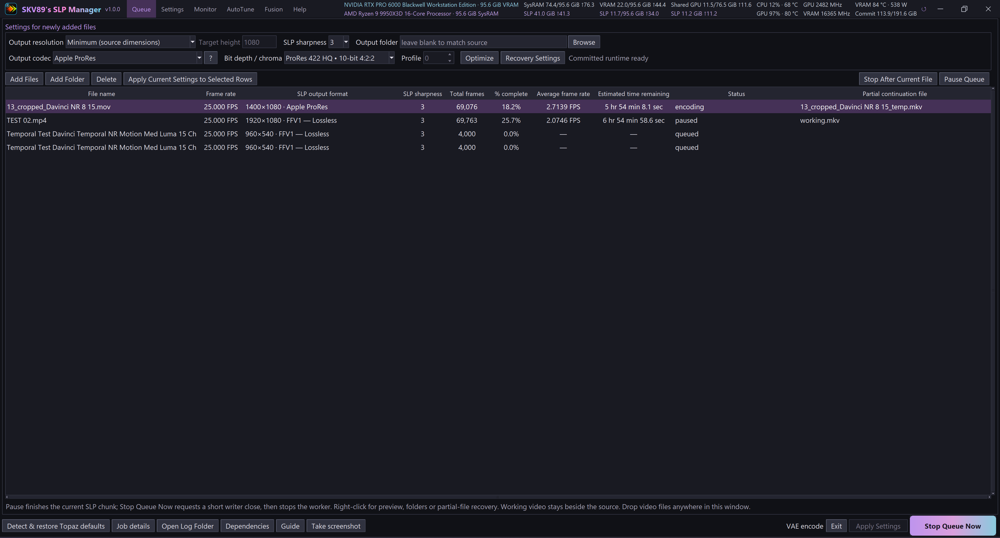

# SKV89's SLP Manager v1.0.0

**SKV89's SLP Manager** is the successor to the original **Topaz SLP Tuning Launcher**, which I created in response to the Topaz community's calls for faster SLP processing and better use of their hardware. Many users felt that SLP was too slow and could not take full advantage of their systems; the original launcher was my answer to that frustration. This more powerful successor adds the features users have requested since that first Topaz SLP Tuning Launcher release: batch processing and queues, custom output resolutions beyond Topaz's standard resolution lock, pause/resume, automatic resume and recovery, manual recovery from partial videos, and configurable out-of-memory (OOM) protection with retry and resume options to improve reliability during long, unattended runs. It also adds expanded tuning, optimization and monitoring features. After Topaz expressed concern that the original Topaz Tuning Launcher app might be mistaken for an official Topaz product, I replaced "Topaz" with "SKV89's" to make its independent origins clear. **This is a community-developed app by me, SKV89, not an app developed or endorsed by Topaz.**

A portable Windows application for queuing, tuning and resuming **Topaz Starlight Precise (SLP)** video processing. Manager uses your licensed Topaz installation and runs its processing backend directly, without opening the Topaz Video interface.

The first public release of SKV89's SLP Manager brings portable queue management, tuning, monitoring and partial-video recovery to licensed Topaz Starlight Precise processing.

- Queue videos with independent output and processing settings, without opening the Topaz Video interface.
- Pause and resume long jobs, or continue from an existing partial video with temporal context at the join.
- Preserve compatible encoded frames, automatically repair supported damage, and regenerate a damaged ending when a usable prefix can be established.
- Use quick metadata admission and qualified index/boundary checks, with deeper verification when required.
- Choose H.264, HEVC NVENC, AV1, FFV1, ProRes or DNxHR output options supported by your system.
- Run AutoTune for conservative/aggressive presets and Optimize for supported verification/encoder resource settings.

**Download:** `SKV89-SLP-Manager-v1.0.0-windows-x64.zip`. Extract it to a writable folder and run `SKV89's SLP Manager.exe`. Keep the supplied notices and licenses with the program. `SHA256SUMS.txt` provides the download checksum.

**Requires:** 64-bit Windows, a suitable NVIDIA GPU, a compatible licensed Topaz Video installation with SLP/Neuroserver, and FFmpeg/FFprobe. Topaz software, models and drivers are not included. The supported processing pipeline is constant-frame-rate SDR; experimental Fusion remains optional.

**Updating from a private preview:** close Manager and replace the supplied program files while preserving your `Data` folder and separately downloaded runtimes. Test a short representative clip before starting a long job.

See the [README](https://github.com/skv89/Topaz-SLP-Manager#readme) for setup, recovery behavior, storage locations and limitations.
